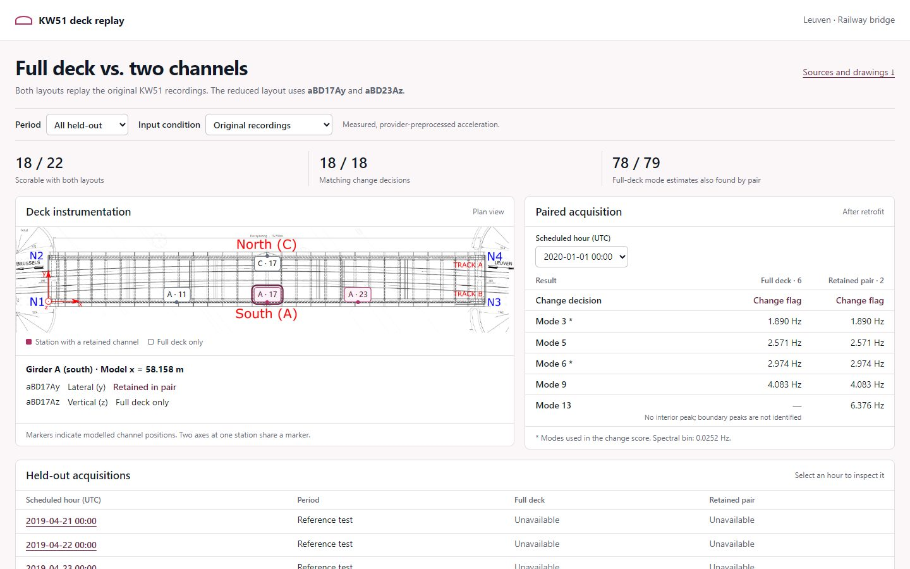

# Low-cost structural health monitoring · KW51 replay

Could two well-placed acceleration channels give the same change decisions as six? This demonstration replays measured vibrations from the KW51 railway bridge in Leuven. It compares the same recording twice, first with all six deck channels and then with two retained channels.



## Read the demonstration

1. **Find the retained channels.** Select **A · 17** for `aBD17Ay` (lateral acceleration) or **A · 23** for `aBD23Az` (vertical acceleration). A channel measures motion at one location in one direction. Both channels come from the bridge's original instruments.
2. **Compare the same hour.** The table shows estimated natural frequencies and the change decision for each layout. A **Change flag** means the frequency score crossed its reference threshold. **No flag** means it stayed within the threshold. **Unavailable** means the data or modal estimates were insufficient.
3. **Try simulated degradation.** Switch **Input condition** from original recordings to added noise, bias, timing skew or burst gaps. The burst-gap case reduced the number of jointly scorable hours from 18 to 13.

With the original recordings, both layouts produced decisions for **18 of 22** held-out hours and agreed on all **18**. The pair also recovered **78 of 79** modal estimates found by the six-channel layout. These are agreement and coverage results for this pilot. Field performance of low-cost MEMS sensors remains to be measured.

[Build and open the dashboard](review/kw51_dashboard.md) · [Read the sensor pilot](review/milestone4_report.md) · [Read the temperature comparison](review/milestone3_report.md)

Screenshot uses KW51 monitoring data by Kristof Maes and Geert Lombaert and the KU Leuven model overview by Kristof Maes, Menno van de Velde and Geert Lombaert. The overview is cropped and annotated with station markers. The screenshot is shared under [CC BY-NC-SA 4.0](https://creativecommons.org/licenses/by-nc-sa/4.0/). [KU Leuven benchmark and credits](https://bwk.kuleuven.be/bwm/kw51)

## Installation

Use Python 3.13 and a project-local virtual environment:

```powershell
python -m venv .venv
.venv/Scripts/python.exe -X utf8 -m pip install -c review/environment-freeze.txt -r requirements-dev.txt
.venv/Scripts/python.exe -X utf8 -m pytest -q
.venv/Scripts/python.exe -X utf8 -m src.verify_mechanics --output outputs/verification.json
```

On Linux use `.venv/bin/python`. CI runs numerical and smoke checks on Windows and Linux. Dependency versions are pinned; the tested resolved environment is recorded in `review/environment-freeze.txt`.

## Numerical research path

The reference is a simply supported Euler–Bernoulli beam: 20 m span, 0.30 by 0.50 m section, E = 30 GPa, density 2,500 kg/m³, and 20 consistent-mass finite elements. Its three retained mass-normalised modes have 2% damping. Inputs are nodal forces in newtons held constant between samples; outputs are acceleration in m/s². Independent sensor noise is added after the response. There is no per-window amplitude normalisation.

The reduced model verifies numerical methods and omits shear deformation, rotary inertia and response from truncated higher modes. The KW51 replay uses Frequency Domain Decomposition (FDD) to estimate frequencies and relative mode shapes. Missing or ambiguous modes are marked unavailable.

## Legacy demonstration

The original artifact is preserved with its checksum and source revision in `review/legacy_manifest.json`. Original runtime, fusion, explanation and resource models are retained under `src/legacy/` for historical inspection. Moving them does not repair their scientific limitations.

The public launchers require explicit opt-in:

```powershell
.venv/Scripts/python.exe -X utf8 -m pip install -c review/environment-freeze.txt -r requirements-legacy.txt
.venv/Scripts/python.exe -X utf8 -m src.main_simulation --legacy --smoke
.venv/Scripts/python.exe -X utf8 -m src.main_simulation --legacy --windows 6
.venv/Scripts/python.exe -X utf8 -m src.train_model --legacy --smoke
```

Open `dashboard/index.html` for the finite legacy stream. Only sensor 0 is classified, matching the original training location. Other channels are displayed without classification. The interface issues no global structural-health assessment. Retraining writes to `outputs/legacy/`, never over the original artifact. The reproduction retains the old in-sample evaluation limitations; synthetic classes are not engineering severity definitions.

The research modules never load the saved classifier. Its legacy loader verifies the original checksum and rejects non-legacy source identifiers before loading or prediction.

## Further experiments

The [KW51 data audit](review/milestone2_kw51.md) documents the monitoring periods and sensing setup. The [bench protocol](review/hardware_bench_protocol.md) describes how to compare a low-cost accelerometer against a calibrated reference.

Author: Majzoob Ali.
